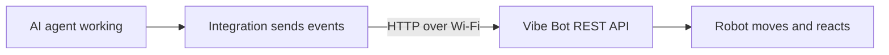

# Vibe Bot

> Give your AI coding agents a body.

> **Based on [Tiny Engineer](https://github.com/jamro/tiny-engineer) by Krzysztof Jamroz** (github.com/jamro/tiny-engineer). Vibe Bot is an independent fork: XIAO ESP32S3 port, multi-session LED bar, and the `vibebot-hub` session aggregator. It is not an official Tiny Engineer product and is not endorsed by the upstream author. Upstream copyright and licence notices are kept — see [License](#license).

> **Photos:** fork-specific photos and a demo of Vibe Bot are TBD. The upstream preview images in `docs/` depict Tiny Engineer branding and are kept only for attribution history; they are not this product's branding (see [TRADEMARK.md](TRADEMARK.md)). For the original robot in action, see the [upstream Tiny Engineer demo video](https://youtu.be/RX_QRxdXMjg).

Vibe Bot is an open-source, 3D-printable desktop robot that physically acts out what your AI coding agents are doing: reading, thinking, coding, finishing tasks (with an audio cue). It runs on an ESP32 over Wi-Fi and exposes a simple REST API, so any tool that can make an HTTP request can drive it.

**[Build your own](#build-your-own) · [How it works](#how-it-works) · [API](docs/api.md) · [Sessions](docs/sessions.md)**

## Why?

AI coding agents increasingly spend long stretches working on their own. Instead of another spinner or status line, Vibe Bot is a tiny teammate on your desk that visibly reads, thinks, and types while the agents work — and its LED bar shows every running session at a glance.

## How it works



An AI agent works; an integration turns that into events; the robot’s REST API on your LAN receives them; the hardware moves and reacts.

**How it connects**

- **Cursor** — Cursor Agent → Cursor hooks → `vibebot-cursor` script → HTTP over Wi-Fi
- **Antigravity CLI** — Antigravity Agent → lifecycle hooks → `vibebot-antigravity` script → HTTP over Wi-Fi
- **Claude Code** — Claude Code → project hooks → `vibebot-claude-code` script → HTTP over Wi-Fi
- **Bring your own** — Codex or any other agent → your script/plugin/app → HTTP REST

All hit the same Vibe Bot REST API (`/anim`, or `/session` for multi-session state). The ESP32 (Seeed XIAO ESP32S3; legacy ESP32-C3-Zero) runs that API, robot logic, and animations, then drives (and plays audio):

| Hardware | Role |
| --- | --- |
| PCA9685 → 5× servos | Head / neck, hands / body |
| Waveshare 0.91inch OLED (SSD1306) | Status, face, info |
| MAX98357A → speaker | Audio |
| 74AHCT1G125 → 9× WS2812B (XIAO build) | Lamp LED + 8-LED session bar |

Cursor is one example client, not the architecture. Details: [Cursor hooks](docs/hooks.md) · [any integration](docs/integration.md) · [HTTP API](docs/api.md)

## Build your own

**Start here:** [docs/getting-started.md](docs/getting-started.md) — thin checklist (shop → print → wire → flash → assemble → wizard → prove → agent).

New to hardware? Optional skim of **[From Code to Circuits](docs/hardware-for-software-engineers/README.md)** — then return to the checklist.

## Hardware overview

Major pieces (exact models and counts in the BOM):

| Role | Part | Qty |
| --- | --- | --- |
| Main Controller | [Seeed Studio XIAO ESP32S3](https://www.seeedstudio.com/XIAO-ESP32S3-p-5627.html) (legacy build: [Waveshare ESP32-C3-Zero](https://www.waveshare.com/esp32-c3-zero.htm), `pio run -e esp32-c3-devkitm-1`) | 1 |
| Servo Controller PWM | [Adafruit PCA9685](https://www.adafruit.com/product/815) | 1 |
| Actuators | Analog micro servos — **Tower Pro SG90 recommended**; Feetech FS0307 for a compact build; Parametrically designed for any standard micro servos | 5 |
| Display | [Waveshare 0.91inch OLED Module](https://www.waveshare.com/0.91inch-oled-module.htm) (SSD1306, 128×32, I2C) | 1 |
| Audio | [MAX98357A](https://www.adafruit.com/product/3006) + [8 Ω / 1 W speaker](https://www.adafruit.com/product/3923) | 1 + 1 |
| LEDs | 9× WS2812B (1 lamp + 8-LED session bar) via a 74AHCT1G125 level shifter, 330 Ω series resistor | 9 |
| USB / power | Dedicated USB-C power input ([Adafruit 5993 USB-C breakout](https://www.adafruit.com/product/5993) or equivalent), **5 V / 3 A** supply, SS14 Schottky into the XIAO 5V pin, 470 µF bulk capacitor | 1 |
| Structure | 3D-printed parts | — |

Complete inventory and limits: [docs/hardware/components.md](docs/hardware/components.md). What to buy (cart + which servo): [docs/shopping.md](docs/shopping.md).

## Quick start

Firmware is Arduino on [PlatformIO](https://platformio.org/). From the project root:

```bash
pio run                 # build
pio run -t upload       # flash firmware + LittleFS
pio device monitor      # serial (115200)
```

If servos move but audio is silent, run `pio run -t uploadfs` once.

**Wi-Fi (first boot):** join `VibeBot-XXXX`, open `http://192.168.4.1/config`. Wizard: servos, screen orientation, RGB LED, speaker, then a **2.4 GHz** network. OLED shows the join-AP steps.

**Web UI:** `http://vibebot.local/` (or the IP on the OLED) — settings, hardware tests, animations.

**Make it move:**

```bash
curl -X POST "http://vibebot.local/anim?name=ring"
```

Full route list: [docs/api.md](docs/api.md). Settings: [docs/settings.md](docs/settings.md).

## AI integrations

Anything that can `POST` over HTTP can drive the robot:

```bash
curl -X POST "http://vibebot.local/anim?name=typing"
```

Useful `name` values: `typing`, `reading`, `thinking`, `ring`, `welcome`, `wakeup`, `sleep`, `attention`, `error`, `abort`, `dead`, `none`.

**Several agents at once:** report each session with `POST /session?id=…&state=idle|working|waiting|error|ended[&activity=typing|reading|thinking][&agent=…][&label=…]` (list: `GET /sessions`, reset: `POST /sessions/clear`). The robot picks one animation by priority and shows every session on the LED bar. Sessions come from the `vibebot-hub` REST pusher or an AgentDeck daemon on the LAN (`agentdeck` setting, default on) — [docs/sessions.md](docs/sessions.md).

Cursor projects can map agent events to poses via hooks — [docs/hooks.md](docs/hooks.md). Broader patterns and examples: [docs/integration.md](docs/integration.md). Optional extra: sleep/wake when you lock or unlock a Mac — [docs/macos-lock-unlock.md](docs/macos-lock-unlock.md).

## Documentation

| Goal | Doc |
| --- | --- |
| Build end-to-end | [docs/getting-started.md](docs/getting-started.md) |
| Flash firmware | [docs/flash.md](docs/flash.md) |
| Parts / cart | [docs/shopping.md](docs/shopping.md) |
| Wiring / power | [docs/hardware/README.md](docs/hardware/README.md) |
| Printable parts | [3d_models/README.md](3d_models/README.md) |
| Assemble printed parts | [docs/3d/assembly.md](docs/3d/assembly.md) |
| Resize CAD for another servo | [docs/3d/parametric-design.md](docs/3d/parametric-design.md) |
| Servo axes / safe ranges | [docs/robot-movement.md](docs/robot-movement.md) |
| HTTP API | [docs/api.md](docs/api.md) |
| Settings | [docs/settings.md](docs/settings.md) |
| Cursor hooks | [docs/hooks.md](docs/hooks.md) |
| Any IDE / REST | [docs/integration.md](docs/integration.md) |
| Firmware / package tests | [docs/testing.md](docs/testing.md) |
| Full index | [docs/README.md](docs/README.md) |

## Build one, break one, share it

Print it, wire it, change the CAD, swap animations, or hook up a different agent. Issues and PRs welcome — especially new integrations. See [CONTRIBUTING.md](CONTRIBUTING.md). Vulnerabilities: [SECURITY.md](SECURITY.md). Conduct: [CODE_OF_CONDUCT.md](CODE_OF_CONDUCT.md).

## License

- **Software** (firmware, integrations, scripts, documentation) — [MIT](LICENSE)
- **Hardware designs** (CAD source and `.3mf` printables in [`3d_models/`](3d_models/); KiCad PCBs in [`hardware/`](hardware/)) — [CERN-OHL-S-2.0](3d_models/LICENSE)

Copyright (c) 2026 Krzysztof Jamroz and contributors. Vibe Bot is based on the Tiny Engineer open hardware design by Krzysztof Jamroz; the upstream Source Location for the CERN-OHL-S designs remains `https://github.com/jamro/tiny-engineer` (see [3d_models/NOTICE](3d_models/NOTICE) and [hardware/NOTICE](hardware/NOTICE)).

See [LICENSING.md](LICENSING.md) for scope and effective date. The **Tiny Engineer** name, logo, AI emblem, and branded project images are not licensed and are not used as this fork's branding — see [TRADEMARK.md](TRADEMARK.md).
