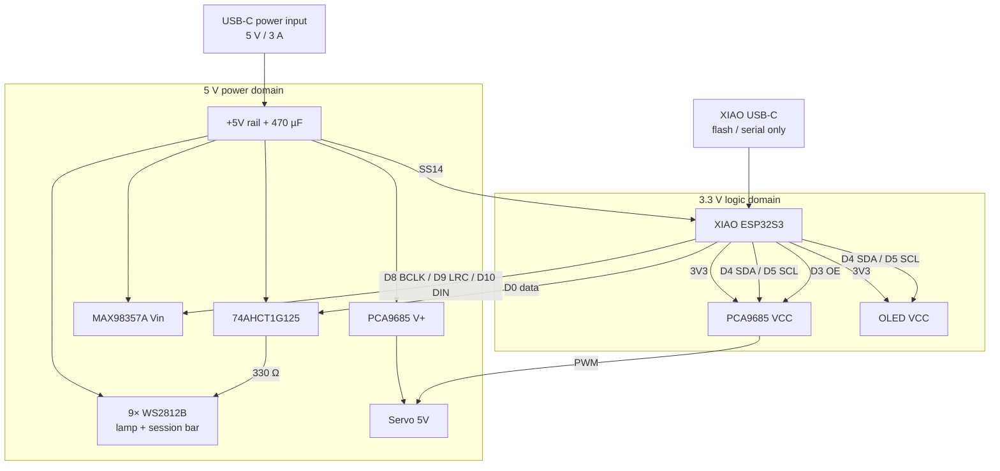

# Vibe Bot — hardware overview

Canonical hardware reference for the Vibe Bot robot (a fork of the Tiny Engineer open hardware design by Krzysztof Jamroz). Default controller: **Seeed Studio XIAO ESP32S3**; the legacy ESP32-C3-Zero build is still supported (`pio run -e esp32-c3-devkitm-1`).

Firmware pin constants live in [`include/pins.h`](../../include/pins.h) / [pinout.md](pinout.md). Wiring: [wiring.md](wiring.md) (a XIAO diagram is TBD; [`docs/wiring/legacy-c3-zero.drawio.png`](../wiring/legacy-c3-zero.drawio.png) covers the legacy C3 harness).

Source of truth: firmware `include/pins.h`, then this `docs/hardware/` set and `docs/wiring/`.

| Audience | Use this set for |
| --- | --- |
| Human | Assembly, wiring, power, bring-up, debugging |
| Firmware agent | Pin map, buses, voltages, servo PWM conventions, test sequence |

## Purpose

Small desktop robot with:

- 5 analog micro servos (head, neck, hands, body — [robot-movement.md](../robot-movement.md))
- I2C OLED status display
- I2S speaker for tones and WAV playback
- 9-LED WS2812B chain: desk lamp + 8-LED session bar ([sessions.md](../sessions.md))
- ESP32-S3 Wi-Fi for HTTP control, AI hooks, and multi-session state

Firmware (`src/main.cpp`) is the robot application: Wi-Fi, settings, hardware tests, animations, sessions, and the JSON API.

## Hardware architecture

One XIAO ESP32S3 owns all logic. Servo PWM is offloaded to a PCA9685 so pulse generation does not depend on ESP32 timing. Audio is I2S into a class-D amp. Display and servo driver share one I2C bus. The LED chain is driven over RMT through a 74AHCT1G125 level shifter.

| Domain | Voltage | What lives there |
| --- | --- | --- |
| Power rail | **+5V** | USB-C power input → PCA9685 **V+** (servos), MAX98357A **Vin**, 74AHCT1G125, WS2812B chain, 470 µF; SS14 → XIAO **5V** |
| Logic | **3V3** | ESP32 GPIO, PCA9685 **VCC**, OLED **VCC**, I2C, I2S |
| Ground | **GND** | Every module — common ground is mandatory |

> [!WARNING]
> Never power the servos from the ESP32 3.3 V regulator.

> [!WARNING]
> MAX98357A SPK- is not ground. Speaker connects between SPK+ and SPK- only.

## Major components

| Role | Part | Qty |
| --- | --- | --- |
| Controller | Seeed Studio XIAO ESP32S3 (legacy: Waveshare ESP32-C3-Zero) | 1 |
| Servo PWM | Adafruit PCA9685 16-channel driver | 1 |
| Actuators | Analog micro servos — **Tower Pro SG90 recommended**; Feetech FS0307 compact; PowerHD HD-1370A still supported | 5 |
| Audio amp | MAX98357A I2S class-D (mono) | 1 |
| Speaker | 8 Ω / 1 W mono | 1 |
| Display | [Waveshare 0.91inch OLED Module](https://www.waveshare.com/0.91inch-oled-module.htm) (SSD1306, 128×32, I2C) | 1 |
| LEDs | WS2812B (1 lamp + 8 session bar) | 9 |
| Level shifter | 74AHCT1G125 + 330 Ω series resistor | 1 |
| Robot power | USB-C power-only input (e.g. Adafruit 5993), 5 V / 3 A; SS14 Schottky; 470 µF bulk cap | 1 |

Full inventory: [components.md](components.md).

## Communication buses

| Bus | XIAO ESP32S3 pins | Devices |
| --- | --- | --- |
| I2C | D4 / GPIO5 SDA, D5 / GPIO6 SCL | PCA9685 `0x40`, SSD1306 `0x3C` |
| I2S | D8 / GPIO7 BCLK, D9 / GPIO8 LRC, D10 / GPIO9 DIN | MAX98357A |
| LED data | D0 / GPIO1 → 74AHCT1G125 | 9× WS2812B |
| PCA9685 OE | D3 / GPIO4 (active low) | PCA9685 |
| Servo PWM | *(none on ESP32)* | PCA9685 channels 0–4 @ 50 Hz |
| USB | XIAO onboard USB-C | Flash, serial CDC |

Legacy C3-Zero pins: [pinout.md](pinout.md#legacy-waveshare-esp32-c3-zero). Details: [interfaces.md](interfaces.md).

## Power architecture

Nominal **+5V** from a dedicated USB-C power input (**5 V / 3 A**), separate from the XIAO's own USB-C. The rail feeds the XIAO **5V** pin through an **SS14** Schottky and carries a **470 µF** bulk capacitor near the servos. The XIAO regulator makes **3V3** for logic only. PCA9685 **V+** (servos) is electrically separate from PCA9685 **VCC** (logic).

Details: [power.md](power.md).

## Documentation map

| File | Contents |
| --- | --- |
| [../shopping.md](../shopping.md) | Buyer cart (electronics, screws, supply) |
| [components.md](components.md) | Inventory, voltages, limits |
| [pinout.md](pinout.md) | GPIO map + allocation rules |
| [wiring.md](wiring.md) | Every electrical connection |
| [power.md](power.md) | Budget, brownout symptoms, USB-C power input |
| [servos.md](servos.md) | PWM, test limits, safe ranges |
| [interfaces.md](interfaces.md) | I2C / I2S / PWM / USB |
| [testing.md](testing.md) | Bring-up sequence, failures, what to check |

Legacy C3 schematic sketch (not a substitute for the tables here): [`docs/wiring/legacy-c3-zero.drawio`](../wiring/legacy-c3-zero.drawio) / [PNG](../wiring/legacy-c3-zero.drawio.png). KiCad PCB sources (when added) live in [`hardware/boards/`](../../hardware/README.md); contribution rules: [`docs/pcb.md`](../pcb.md). Until a board is merged, the wiring tables here remain the electrical source of truth.

## Source-of-truth order

1. Repository firmware / `include/pins.h`
2. This `docs/hardware/` set and `docs/wiring/`
3. Component datasheets
