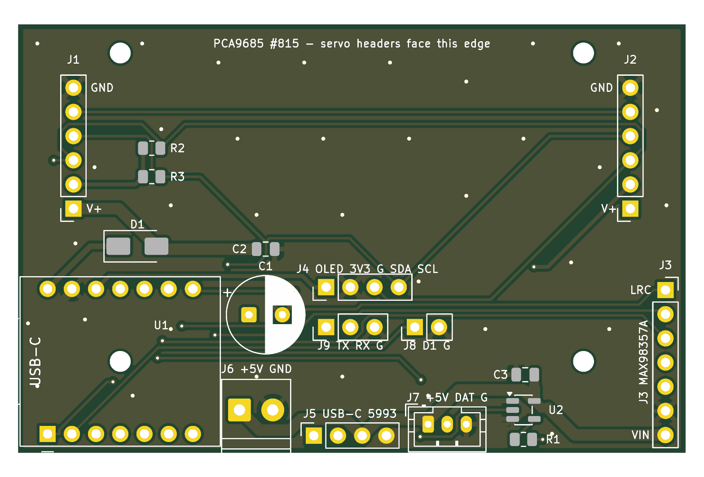

# xiao-main-board

Carrier PCB for the Seeed XIAO ESP32S3 build: hand-solderable sockets for the existing modules, a 5 V / 3 A power input, a buffered WS2812 output, and small aux headers. Same idea as [`main-control-board`](../main-control-board/) (sockets, not integrated chips), sized for the robot base.



- **Status:** draft, not manufactured (rev v0.1, 2026-10-18). Schematic and fully routed layout, KiCad review only.
- **KiCad:** 10 (checked with kicad-cli 10.0.7)
- **Board:** 70.0 × 45.0 mm, 2 layers, FR4 1.6 mm, 1 oz. GND pour on both layers with stitching vias. 4 × M2 mounting holes (2.2 mm NPTH) at (10.7, 3.0), (59.3, 3.0), (10.7, 35.4) and (59.3, 35.4) mm from the top-left corner. The two lower holes sit under the XIAO and the MAX98357A modules, so screw the board down before plugging those in.
- **Interfaces:** XIAO ESP32S3 (2 × 1×7 sockets), Adafruit PCA9685 #815 (2 × 1×6 sockets), MAX98357A breakout (1×7 socket), SSD1306 OLED (1×4 header), Adafruit 5993 USB-C breakout (1×4 socket, power only), 2-pin screw terminal, WS2812 JST-PH 3-pin, touch 1×2 header, UART 1×3 header.
- **Built:** not manufactured. **Tested:** not tested.
- **ERC / DRC:** `python3 scripts/check_pcb.py` passes: ERC 0 errors, DRC 0 errors / 0 unconnected / 0 schematic-parity issues, and the netlist matches `expected-nets.yml`. The remaining warnings are listed under [Known warnings](#known-warnings).

Pin plan and firmware mapping: [`include/pins.h`](../../../include/pins.h) and [`docs/hardware/pinout.md`](../../../docs/hardware/pinout.md). Contribution rules: [`docs/pcb.md`](../../../docs/pcb.md).

## XIAO ESP32S3 pinout used

The XIAO plugs in with its USB-C facing the left board edge. The receptacle overhangs the board by about 1.5 mm, and the overhang is marked on silkscreen and courtyard.

| XIAO | GPIO | Net | Goes to |
| --- | --- | --- | --- |
| D0 | 1 | `LED_DIN_3V3` | U2 74AHCT1G125 input A |
| D1 | 2 | `TOUCH_D1` | J8.1 (reserved: touch pad or button) |
| D2 | 3 | open | S3 strapping pin, left unused |
| D3 | 4 | `PCA_OE` | J1.5 / J2.5 PCA9685 OE (active low) |
| D4 | 5 | `I2C_SDA` | PCA9685, OLED, optional R2 |
| D5 | 6 | `I2C_SCL` | PCA9685, OLED, optional R3 |
| D6 | 43 | `UART_TX` | J9.1 |
| D7 | 44 | `UART_RX` | J9.2 |
| D8 | 7 | `I2S_BCLK` | J3.2 MAX98357A BCLK |
| D9 | 8 | `I2S_LRC` | J3.1 MAX98357A LRC |
| D10 | 9 | `I2S_DIN` | J3.3 MAX98357A DIN |
| 5V | – | `+5V_XIAO` | D1 SS14 cathode |
| 3V3 | – | `+3V3` | PCA9685 VCC, OLED VCC, R2/R3 |
| GND | – | `GND` | |

Source for the pin numbers: Seeed's own KiCad library ([Seeed-Studio/OPL_Kicad_Library](https://github.com/Seeed-Studio/OPL_Kicad_Library), commit `b0035c5`, "Seeed Studio XIAO Series Library": symbol `XIAO-ESP32-S3-SMD` and footprint `XIAO-ESP32-S3-DIP`). Pins 1–7 are D0–D6 down the left side with USB at the top. Pins 8–14 are D7, D8, D9, D10, 3V3, GND and 5V going up the right side. That matches the Seeed wiki pinout (left side D0…D6, right side 5V, GND, 3V3, D10, D9, D8, D7 from top to bottom). The project symbol and footprint (`libraries/`, nickname `XiaoMainBoard`) were redrawn from those dimensions: 21 × 17.8 mm module, 2.54 mm pitch, rows 15.24 mm apart.

## Power

```
J5 (5993 VBUS) ─┐
J6 (terminal +)─┴─ +5V rail ─┬─ C1 470 µF + C2 100 nF
                             ├─ J1.1 / J2.1  PCA9685 V+ (servos)   ← 1.5 mm back-layer trunk
                             ├─ J3.7 MAX98357A VIN
                             ├─ J7.1 LED chain + U2 VCC (C3 100 nF)
                             └─ D1 SS14 ──► +5V_XIAO ── XIAO 5V pin
```

- **SS14 orientation** (confirmed in the `kicad-cli sch export netlist` output): **anode `D1.2:A` on `+5V`** (the rail) and **cathode `D1.1:K` on `+5V_XIAO`**, which is the XIAO 5V pin `U1.14`. The rail can feed the XIAO, but a USB host plugged into the XIAO cannot back-feed the servo rail. The SMA cathode band is pad 1, toward the left (XIAO) side. The silkscreen shows the band.
- Use a single **5 V / 3 A** supply on J5 (Adafruit 5993) **or** J6 (screw terminal), not both at once. The XIAO's own USB-C is for flashing and serial only. Do not power the servos from it.
- PCA9685 **VCC** = `+3V3` (logic) and **V+** = `+5V` (servo rail). They are separate nets. Do not bridge them.
- When the XIAO USB and the rail are both live, the XIAO 5V pin sees about rail − 0.35 V through D1 and the host's VBUS in parallel. A rail above about 5.3 V could make the rail the supply that wins (see [review items](#needs-human-review-before-ordering)).
- Net classes in `xiao-main-board.kicad_pro`, with matching rules in `xiao-main-board.kicad_dru`:

  | Class | Nets | Default width | DRU minimum |
  | --- | --- | --- | --- |
  | `Power5V` | `+5V` | 1.2 mm | 1.0 mm |
  | `Power5VXiao` | `+5V_XIAO` | 0.6 mm | 0.5 mm |
  | `Power3V3` | `+3V3` | 0.4 mm | 0.4 mm |
  | `GND` | `GND` | 0.4 mm | 0.4 mm |
  | `Default` | signals | 0.25 mm | – |

  The servo trunk from J6 through C1 to both PCA9685 V+ pins is 1.5 mm on the back layer.

## Connector pinouts

| Ref | Part | Pin 1 → n |
| --- | --- | --- |
| U1 | XIAO ESP32S3 on 2 × 1×7 sockets | see table above |
| J1, J2 | PCA9685 #815 sockets, 58.42 mm apart | 1 V+ (`+5V`), 2 VCC (`+3V3`), 3 SDA, 4 SCL, 5 OE (`PCA_OE`), 6 GND. Same order as main-control-board; V+ is the lower pin. |
| J3 | MAX98357A 1×7 socket | 1 LRC, 2 BCLK, 3 DIN, 4 GAIN (open), 5 SD (open), 6 GND, 7 VIN (`+5V`) |
| J4 | OLED 1×4 male header | 1 VCC (`+3V3`), 2 GND, 3 SDA, 4 SCL. Same order as main-control-board J2. |
| J5 | Adafruit 5993 1×4 socket | 1 D+ (open), 2 D− (open), 3 VBUS (`+5V`), 4 GND. Same order as main-control-board J7; data is not used. |
| J6 | Screw terminal, 3.5 mm pitch | 1 `+5V`, 2 GND. The wire entry faces the bottom edge. |
| J7 | JST-PH 3-pin (B3B-PH-K) | 1 `+5V`, 2 DATA (`LED_DATA`, after 330 Ω), 3 GND. Chain: index 0 lamp LED, then the 8-LED session bar. |
| J8 | 1×2 header | 1 `TOUCH_D1` (XIAO D1), 2 GND |
| J9 | 1×3 header | 1 TX (D6), 2 RX (D7), 3 GND. These are XIAO-side names: connect the adapter's RX to pin 1. |

## BOM

| Qty | Ref | Value / part | Footprint | Example part number |
| --- | --- | --- | --- | --- |
| 1 | U1 | Seeed Studio XIAO ESP32S3 (U.FL antenna included) | `XiaoMainBoard:Seeed_XIAO_ESP32S3_Socketed` | Seeed 113991114 |
| 2 | (U1) | 1×7 female header, 2.54 mm, 8.5 mm tall | (part of the U1 footprint) | Würth 61300711821 |
| 1 | U2 | 74AHCT1G125, SOT-23-5 | `Package_TO_SOT_SMD:SOT-23-5` | TI SN74AHCT1G125DBVR |
| 1 | D1 | SS14 Schottky, 1 A 40 V | `Diode_SMD:D_SMA` | SS14 (onsemi / MCC) |
| 1 | C1 | 470 µF 10 V electrolytic, 8 × 11.5 mm | `Capacitor_THT:CP_Radial_D8.0mm_P3.50mm` | Panasonic EEU-FR1A471 |
| 2 | C2, C3 | 100 nF X7R 25 V | `Capacitor_SMD:C_0805_2012Metric` | Yageo CC0805KRX7R9BB104 |
| 1 | R1 | 330 Ω 1 % | `Resistor_SMD:R_0805_2012Metric` | Yageo RC0805FR-07330RL |
| 2 | R2, R3 | 4.7 kΩ 1 %, **DNP** | `Resistor_SMD:R_0805_2012Metric` | Yageo RC0805FR-074K7L |
| 2 | J1, J2 | 1×6 female header, 2.54 mm | `Connector_PinSocket_2.54mm:PinSocket_1x06_P2.54mm_Vertical` | Würth 61300611821 |
| 1 | J3 | 1×7 female header, 2.54 mm | `…PinSocket_1x07_P2.54mm_Vertical` | Würth 61300711821 |
| 1 | J5 | 1×4 female header, 2.54 mm | `…PinSocket_1x04_P2.54mm_Vertical` | Würth 61300411821 |
| 1 | J4 | 1×4 male header | `Connector_PinHeader_2.54mm:PinHeader_1x04_P2.54mm_Vertical` | Würth 61300411121 |
| 1 | J9 | 1×3 male header | `…PinHeader_1x03_P2.54mm_Vertical` | Würth 61300311121 |
| 1 | J8 | 1×2 male header | `…PinHeader_1x02_P2.54mm_Vertical` | Würth 61300211121 |
| 1 | J6 | 2-pin screw terminal, 3.5 mm | `TerminalBlock_Phoenix:TerminalBlock_Phoenix_PT-1,5-2-3.5-H_1x02_P3.50mm_Horizontal` | Phoenix Contact 1984617 |
| 1 | J7 | JST-PH 3-pin vertical (mates PHR-3) | `Connector_JST:JST_PH_B3B-PH-K_1x03_P2.00mm_Vertical` | JST B3B-PH-K-S |
| 4 | H1–H4 | M2 screws + standoffs (no part on the board) | `MountingHole:MountingHole_2.2mm_M2` | – |
| – | modules | PCA9685 (Adafruit 815), MAX98357A breakout, SSD1306 0.91" OLED, Adafruit 5993, WS2812B × 9 | plug in | see [`docs/hardware/components.md`](../../../docs/hardware/components.md) |

All stock symbols and footprints come from the KiCad 10 libraries. They are also embedded in the `.kicad_sch` / `.kicad_pcb` files, so the project opens without the global libraries. The only custom parts are the XIAO symbol and footprint in `libraries/`.

## Assembly order

1. SMD parts: U2 (check the pin-1 dot), R1, C2, C3, D1 (cathode band toward the XIAO / left). R2/R3 are DNP.
2. Low THT parts: the J9/J8/J4 headers, J7 JST, J6 terminal.
3. Sockets: XIAO 2 × 1×7, J1/J2 1×6, J3 1×7, J5 1×4. Seat each one square, for example with the module plugged in while you solder.
4. C1 470 µF last. Watch polarity: `+` is the square pad, next to the XIAO.
5. Screw the board down (4 × M2) **before** you plug in the XIAO and the MAX98357A. Two holes are under them.
6. Before plugging in any module: apply 5 V on J6 with a current-limited bench supply. Check `+5V` on J1.1, J2.1, J3.7 and J7.1, about 4.6–4.7 V on the XIAO 5V socket pin, and no short to GND.
7. Plug in the modules. The PCA9685 sits over the SMD area between J1 and J2, about 11 mm up, with its servo header strip toward the top board edge. The MAX98357A sits over U2/R1/C3. The Adafruit 5993 overhangs the bottom edge.

## Bench safety

- Use a **5 V / 3 A** supply on J5 or J6 only. Never power the servos from the XIAO USB-C or from its 3.3 V regulator.
- Keep the XIAO U.FL antenna and its FPC/rod antenna clear of metal, the servo wiring and dense plastic. Route it away from the PCA9685 and servo rail.
- MAX98357A outputs are bridge-tied: **SPK− is not ground.**

## Known warnings

`check_pcb.py` gates only on errors. With `--severity-all` these warnings remain:

- `lib_symbol_issues` / `footprint_link_issues` / `lib_footprint_issues`: the CI and dev container has no stock KiCad libraries installed. The parts are embedded in the files, and these warnings go away on a normal KiCad install.
- `silk_edge_clearance` (4): intentional. The silkscreen marks the XIAO USB-C overhang and the J6 terminal body, which reach the board edge.
- Pad J5.4 (GND) uses a solid zone connection. The back-layer pour around it is an island between signal tracks, which DRC reports as a starved thermal relief. It is connected through the front pour.

## Needs human review before ordering

- Check the PCA9685 #815 header spacing (58.42 mm assumed, same as main-control-board) and which long edge the servo headers are on. Check the generic MAX98357A breakout size (about 18 × 19 mm assumed, overhanging U2/R1/C3) and the Adafruit 5993 header order and orientation (copied from main-control-board J7).
- OLED pin order: J4 is VCC, GND, SDA, SCL. Many 0.91" modules are GND, VCC, SCL, SDA, so check yours or use a crossed cable.
- The XIAO USB-C and the external 5 V should not both be live with a rail above about 5.3 V (see Power).
- Layout was autorouted (Freerouting) and then cleaned up: GND stitching, +5V neck-downs widened to the 1 mm rule, a locked 1.5 mm servo trunk. Review the GND return path for servo current in region B. Most of it flows on the front pour because the back +5V trunk splits the back pour.
- Check that the mounting holes line up with the enclosure ("under the desk" base), and check the stack-up heights: modules sit about 11 mm above the PCB on 8.5 mm sockets, and C1 is 11.5 mm tall.
- Run the GUI DRC once with the stock libraries installed (footprint/library mismatch check).

## Files

- `xiao-main-board.kicad_pro` / `.kicad_sch` / `.kicad_pcb` / `.kicad_dru`, `sym-lib-table`, `fp-lib-table`
- `libraries/symbols/xiao_main_board.kicad_sym`, `libraries/footprints/xiao_main_board.pretty/`
- `expected-nets.yml`: every named net (critical net list for review)
- `xiao-main-board-render-top.png`, `xiao-main-board-render-bottom.png`: `kicad-cli pcb render` output

## License

CERN-OHL-S-2.0. See [`hardware/LICENSE`](../../LICENSE) and [`hardware/NOTICE`](../../NOTICE). This board is part of Vibe Bot, a fork of Tiny Engineer by Krzysztof Jamroz.
